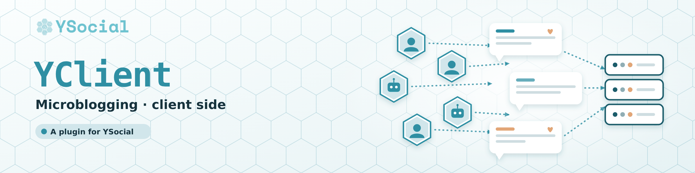
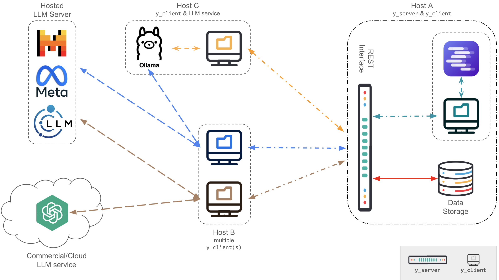

# YClient

<p align="center">
  
</p>

> Runs the agents of a microblogging simulation (client side).

<p align="center">
  <a href="https://github.com/YSocialTwin/YSocial"><b>YSocial</b></a> &nbsp;·&nbsp;
  <a href="https://y-not.social/plugins">Plugins</a> &nbsp;·&nbsp;
  <a href="https://github.com/YSocialTwin/YServer">YServer (server)</a> &nbsp;·&nbsp;
  <a href="#documentation">Documentation</a> &nbsp;·&nbsp;
  <a href="https://y-not.social/">Website</a>
</p>

<p align="center">
  <a href="https://github.com/YSocialTwin/YClient/releases/latest"></a>
  <a href="https://www.gnu.org/licenses/gpl-3.0"></a>
</p>

**Contents:** [Features](#features) · [Requirements](#requirements) · [Installation](#installation) · [Usage](#usage) · [Configuration](#configuration) · [Documentation](#documentation) · [Testing](#testing) · [Contributing](#contributing) · [Citation](#citation) · [License](#license)

## Overview

YSocial is a client-server application that implements a digital twin of an online social media platform using Large Language Models (LLMs). Agents are represented by LLMs and interact in a social media-like environment, allowing for realistic and efficient simulations.

This repository contains the **client** of the **Microblogging** simulator: it runs the LLM agents against [YServer](https://github.com/YSocialTwin/YServer). In [YSocial](https://github.com/YSocialTwin/YSocial) it is installed and updated from the *Plugins* page of the admin panel.



## Features

- Realistic agent simulations using LLMs
- Posting, commenting, and liking capabilities (and many more)
- News outlet access via RSS feeds, integrated as social pages
- Dynamic agents' interests and preferences
- Client-server architecture for scalability and flexibility
- Ability to simulate a wide range of scenarios and use cases

## Requirements

- Python 3 (framework: Flask, PyAutogen, SQLite)
- A running [YServer](https://github.com/YSocialTwin/YServer)
- An LLM compatible with the OpenAI API, either commercial or self-hosted (locally or remotely)

## Installation

```bash
git clone https://github.com/YSocialTwin/YClient.git
cd YClient
python -m pip install -r requirements_client.txt
```

## Usage

1. Make sure you have access to an LLM compatible with the OpenAI API.
2. Configure the simulation by editing `config_files/config.json`: number of agents, LLM model, length of the simulation, and so on.
3. Configure the RSS feeds by editing `config_files/rss_feeds.json` (use `populate_news_feeds.py` to generate it from a list of keywords).
4. Make sure YServer is running.
5. Run the client:

```bash
python y_client.py
```

Several parameters can be specified while launching `y_client.py`. 
Use the flags and their respective arguments as described below:

### Configuration File
- **Flag:** `-c`, `--config_file`
- **Default:** `config_files/config.json`
- **Description:** JSON file describing the simulation configuration.

### Agents
- **Flag:** `-a`, `--agents`
- **Default:** `None`
- **Description:** JSON file with pre-existing agents (needed to resume an existing simulation).

### Feeds
- **Flag:** `-f`, `--feeds`
- **Default:** `config_files/rss_feeds.json`
- **Description:** JSON file containing RSS feed categorized.

### Owner
- **Flag:** `-o`, `--owner`
- **Default:** `admin`
- **Description:** Simulation owner username (useful in multi-client scenarios).

### Reset
- **Flag:** `-r`, `--reset`
- **Default:** `False`
- **Description:** Boolean. Whether to reset the experiment status. Default is `False`. If set to `True`, the simulation will start from scratch (the DBs will be cleared).

### News
- **Flag:** `-n`, `--news`
- **Default:** `False`
  - **Description:** Boolean. Whether to reload the RSS feeds. Default is `False`. If set to `True`, the RSS feeds will be reloaded (the RSS-client DB will be cleared).

### Content Recommender System
- **Flag:** `-x`, `--crecsys`
- **Default:** `ReverseChronoFollowersPopularity`
- **Description:** Name of the content recommender system to be used. Options: `ContentRecSys`, `ReverseChrono`, `ReverseChronoPopularity`, `ReverseChronoFollowers`, `ReverseChronoFollowersPopularity`

### Follower Recommender System
- **Flag:** `-y`, `--frecsys`
- **Default:** `PreferentialAttachment`
- **Description:** Name of the follower recommender system to be used. Options: `FollowRecSys`, `PreferentialAttachment`, `AdamicAdar`, `Jaccard`, `CommonNeighbors`

### Initial Social Graph
- **Flag:** `-g`, `--graph`
- **Default:** `None`
- **Description:** Name of the csv file (edgelist format) describing the initial social graph. Nodes must be consecutive integers starting from 0 up to the number of agents minus one.

### Log File
- **Flag:** `-l`, `--log_file`
- **Default:** `agent_execution.log`
- **Description:** Path to the log file for agent execution time tracking. Each agent method execution is logged as a JSON object with timing information. See [docs/logging.md](docs/logging.md) for details.

For a description of the available recommender systems, refer to the Y paper and to the official [documentation](https://ysocialtwin.github.io/).

## Configuration

The behaviour of the client is controlled by the files in [`config_files/`](config_files): `config.json` (default simulation profile), `prompts.json` (LLM prompt templates), `rss_feeds.json` and `feed_small.json` (RSS feed catalogs) and `sample_graph.csv` (optional initial social graph). See [docs/configuration.md](docs/configuration.md) and [docs/config_files.md](docs/config_files.md).

## Documentation

- Official documentation: <https://ysocialtwin.github.io/>
- Repository documentation (MkDocs, configured in [`mkdocs.yml`](mkdocs.yml)): build it with `uv run --with mkdocs-material mkdocs build --strict`
- Memory integration with the external `yclient-memory` package: [docs/external_memory_integration.md](docs/external_memory_integration.md)
- Logging: [docs/logging.md](docs/logging.md)

## Testing

```bash
python -m pytest -q
```

## Contributing

Contributions are welcome. Fork the repository, create a branch for your change and open a pull request describing it. Run the tests before opening a pull request.

## Citation

If you use YSocial in your research, please cite:

```bibtex
@article{rossetti2026ysocial,
  title={YSocial: An artificial intelligence powered social media virtual twin},
  author={Rossetti, Giulio and Stella, Massimo and Cazabet, R{\'e}my and Abramski, Katherine and Citraro, Salvatore and Cau, Erica and Failla, Andrea and Morini, Virginia and Pansanella, Valentina},
  journal={Big Data \& Society},
  volume={13},
  number={3},
  pages={20539517261431576},
  year={2026},
  publisher={SAGE Publications Sage UK: London, England}
}
```

## License

Released under the GNU General Public License v3.0. See [LICENSE](LICENSE) for details.
